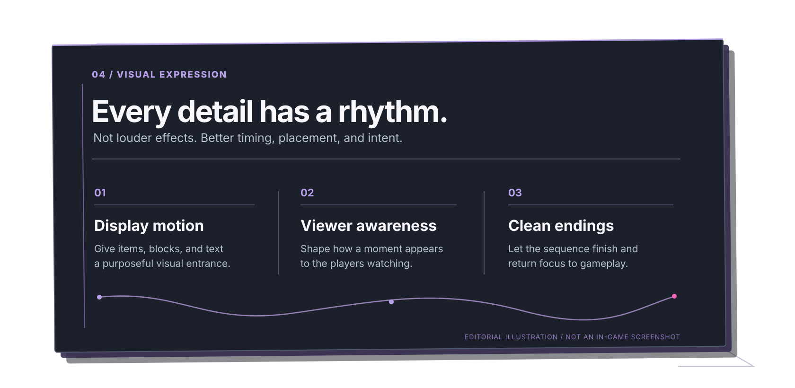

  

# VAnimation 

**Motion made meaningful.**

The details between gameplay moments can define the entire experience. A transition that feels natural. A display that draws attention at the right time. An effect that knows when to end.

**VAnimation** is VACK STUDIO's shared animation layer for Minecraft plugins. It brings visual sequences into one coordinated system, while the games using it stay in charge of their own gameplay, movement, and rewards.

## Make every moment move 

From brief visual cues to more expressive sequences, VAnimation brings a consistent approach to creating motion across Minecraft experiences.

The prepared animation engine covers **item, block, and text displays**, with transforms and per-viewer visibility. Its documented effect collection includes **six vanilla effects and six Sugarverse effects**, offering a starting point for different visual moods.

  

The goal isn't to add movement everywhere. It's to make each animation feel like it belongs to the moment.

## A shared language for visual effects

| Capability | The creative value |
| :--- | :--- |
| **Timeline sequences** | Shape an effect with a defined beginning, progression, and finish |
| **Display animation** | Bring item, block, and text displays into a coordinated visual scene |
| **Transforms and visibility** | Adjust how displays appear and who sees them |
| **Consumer ownership** | Let each game control the sequences it starts |
| **Cancellation and cleanup** | End an effect cleanly without leaving its owned resources behind |
| **Priority and limits** | Keep concurrent visual work bounded and manageable |

These capabilities describe the prepared VAnimation preview; individual integrations should be evaluated against their actual build.

## Visuals with a purpose 

  

Great Minecraft visuals support the game instead of obscuring it. A little movement can emphasize an important event; a longer sequence can establish atmosphere; a precisely timed ending leaves the screen ready for what happens next.

For themed experiences, the optional **Sugarverse demonstration** explores custom display models, items, and blocks. Its sample content is a demonstration of presentation concepts—not a claim that Minecraft gains new client-side block registrations.

## Built to collaborate

VAnimation focuses on visual orchestration, so consuming plugins can focus on their own game flow. The prepared design includes consumer-scoped handles, completion outcomes, queued work, and lifecycle cleanup.

The public project showcase does **not** provide the full implementation, an installation package, or a supported integration guide. Obtain the appropriate version and documentation through VACK STUDIO before using it in a server environment.

<strong>Technical reference and release status</strong>

The documented prepared build is **0.3.0-preview.1**, targeting Minecraft Java 26.2, Java 25, and Paper API 26.2.build.134-stable.

Its preparation included 69 passing Java tests and 12 passing resource-pack tests, with byte-identical JAR rebuilds from the delivered source. **Real-server, graphical-client, and mixed-language multiplayer acceptance was not completed.** Compatibility with Folia, Leaf, Bedrock, and proxy platforms is not certified.

The optional demonstration contains 50 items and 50 placeable block types, including three sword designs with a configurable self-only Speed/Resistance ability. Demonstration blocks use vanilla glass collision carriers with display models; they are not new client-registry blocks. Lantern glow does not create real block light, and audio playback integration remains deferred.

Language options documented for the preview are English by default and explicit English / العربية selection, with UUID-based preferences. Resource-pack readiness checks include version, hash, and `APPLIED` status.

This is a **prepared preview**, not a verified stable public release.

## Access and licensing

**VAnimation is proprietary software by VACK STUDIO.** This public repository is a presentation of the project, not a source or binary distribution. Viewing the repository does not grant permission to copy, modify, redistribute, or commercially use its original software or visual assets.

For licensing and authorized access, contact VACK STUDIO using the links below. See [LICENSE](LICENSE) for the full rights notice.

---

  

  
  &nbsp;&nbsp;&nbsp;&nbsp;
  

<strong>Artwork credits</strong>

Copyright © 2026 VACK STUDIO. All rights reserved.

The original V22 Mini Zoiila **Edge Sitter** pose decorates the first banner. Small Mini Zoiila emojis are existing Vgtb studio assets, while the interior banners are editorial illustrations rather than in-game screenshots. Third-party works remain subject to their owners' terms.

