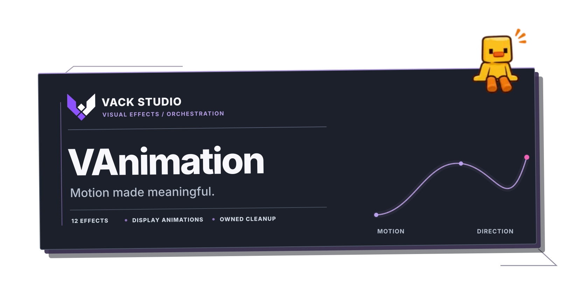
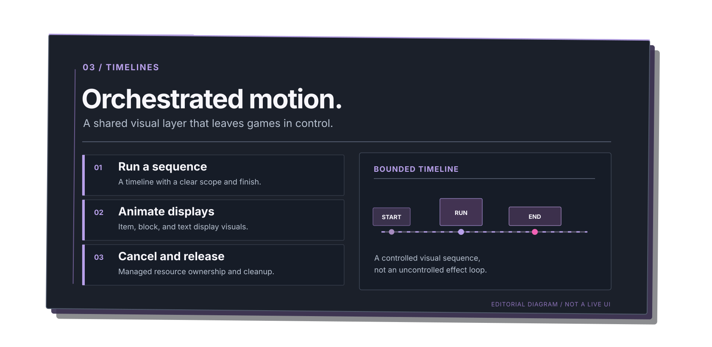
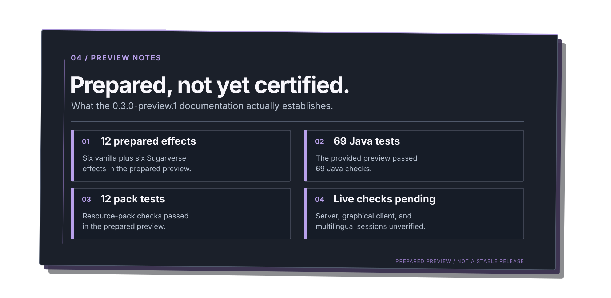
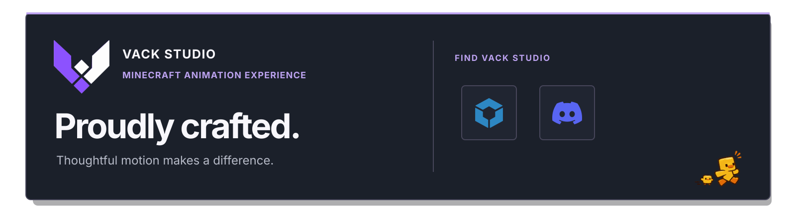

  

# VAnimation 

**Make motion feel intentional.**

A well-timed visual can make a Minecraft experience feel more alive. **VAnimation**, by **VACK STUDIO**, provides shared animation orchestration for Minecraft plugins: bounded timelines, controlled cancellation, and cleanup of owned resources. The consuming games retain ownership of their rules, movement, and rewards.

> [!IMPORTANT]
> **Prepared preview — not a stable public release.** The documented build is **0.3.0-preview.1**. Although its source and runtime JARs passed the stated rebuild checks, real-server gameplay, graphical-client presentation, and mixed-language multiplayer acceptance have **not** been completed. This public repository is a showcase, not a source-code or binary distribution.

## Motion, under control 

**An animation should have a beginning, a defined scope, and a clean finish.**

The prepared VAnimation preview documents consumer-scoped handles, completion outcomes, priority queues, configurable resource limits, and cancellation. Its visual effects include item, block, and text display animation, transforms, and per-viewer visibility.

  

| Documented area | Prepared preview scope |
| :--- | :--- |
| **Effect collection** | 12 effects: six vanilla effects and six Sugarverse effects |
| **Timeline control** | Consumer-scoped handles, completion outcomes, cancellation, and priority queues |
| **Resource control** | Configurable resource limits and owned-resource cleanup |
| **Animated displays** | Item, block, and text displays, transforms, and per-viewer visibility |
| **Optional Sugarverse demo** | 50 items and 50 placeable block types; three sword designs with configurable self-only Speed/Resistance ability |
| **Pack readiness** | Paginated test kits and exact version, hash, and `APPLIED` readiness checks |
| **Language preferences** | English by default, explicit English / العربية selection, UUID-based preferences |

*The illustration above explains the system concept. It is not a screenshot of VAnimation running in-game.*

## Preview checks and limits 

  

The documented preview targets **Minecraft Java 26.2**, **Java 25**, and **Paper API 26.2.build.134-stable**. The prepared source passed **69 Java tests** and **12 resource-pack tests**; both runtime JARs were rebuilt byte-identically from the delivered source.

Those results confirm preparation and repeatability, **not** finished real-client acceptance.

| Verification area | Documented status |
| :--- | :--- |
| Java tests | **69 passed** |
| Resource-pack tests | **12 passed** |
| Reproducible JAR rebuild | **Byte-identical from the delivered source** |
| Real-server acceptance | **Not completed** |
| Graphical-client acceptance | **Not completed** |
| Mixed-language multiplayer acceptance | **Not completed** |
| Folia, Leaf, Bedrock, and proxy certification | **Not claimed** |

### Technical boundaries

The optional demonstration blocks use **vanilla glass collision carriers** with custom display models; they are **not** new client-registry block types. Lantern brightness is a visual effect and does **not** create real block light. Audio playback integration remains deferred.

These notes document the **0.3.0-preview.1** preparation only. They should not be read as promises about later builds or stable compatibility.

## Availability and licensing

VAnimation source code and installable artifacts are **distributed privately**. This public repository provides project information only, without JAR downloads or source distribution.

**License:** Proprietary — All rights reserved. See [LICENSE](LICENSE).

---

## العربية

**VAnimation** إضافة مشتركة لتنسيق الأنيميشن لإضافات Minecraft، مع تسلسلات زمنية محدودة وإلغاء وتنظيف للموارد المملوكة. تبقى قواعد اللعب والنقل والمكافآت من مسؤولية اللعبة المستهلكة.

### النسخة التجريبية المجهّزة: 0.3.0-preview.1

- **12 مؤثرًا:** ستة مؤثرات فانيلا وستة مؤثرات Sugarverse.
- **إدارة التشغيل:** تشغيل وإلغاء معزولان بحسب الإضافة المستهلكة، وقوائم انتظار بالأولوية، وحدود موارد قابلة للتخصيص.
- **العرض المرئي:** أنيميشن للعناصر والبلوكات والنصوص، مع التحويلات والظهور الخاص لكل مشاهد.
- **التجربة الاختيارية:** 50 آيتم و50 نوع بلوك قابل للوضع، وثلاثة تصاميم سيوف بقدرة سرعة ومقاومة مؤقتة قابلة للتخصيص.
- **الريسورس باك:** دفعات اختبار والتحقق من الإصدار والهاشات وحالة `APPLIED`.
- **اللغة:** الإنجليزية افتراضيًا، واختيار English / العربية صراحةً، وحفظ التفضيلات بحسب UUID.

الهدف هو **Minecraft Java 26.2 وJava 25** مع **Paper API 26.2.build.134-stable**. اجتازت النسخة المجهّزة **69 اختبار Java و12 اختبار resource pack**، وأُعيد بناء الجارين من السورس المرفق بنتائج متطابقة بايتًا ببايت.

**التحقق غير مكتمل:** لم تنتهِ اختبارات السيرفر الحقيقي والعميل الرسومي واللاعبين بلغتين. لا يوجد ادعاء بتوافق Folia أو Leaf أو Bedrock أو Proxy.

بلوكات التجربة تستخدم تصادم زجاج فانيلا مع موديلات عرض مخصصة، وليست بلوكات جديدة مسجلة لدى العميل. سطوع الفانوس مرئي ولا يصنع إضاءة حقيقية للبلوكات، وتكامل تشغيل الصوت مؤجل. النسخة المجهّزة تجريبية وليست إصدارًا مستقرًا.

### التوفر والترخيص

المصدر والملفات التنفيذية توزّع بصورة خاصة، والمستودع العام تعريفي فقط بلا ملفات تنفيذية أو روابط تنزيل. الترخيص **ملكية خاصة — جميع الحقوق محفوظة**. راجع [LICENSE](LICENSE).

---

  

  
  &nbsp;&nbsp;&nbsp;&nbsp;
  

<strong>Artwork and documentation credits</strong>

Copyright © 2026 VACK STUDIO. All rights reserved.

The **Top Peek** Mini Zoiila mascot appearing on the first banner is the original V22 drawing, retained as artwork rather than regenerated. The small Mini Zoiila emojis are the existing Vgtb assets. Visual diagrams are editorial illustrations, **not** Minecraft screenshots or evidence of runtime acceptance. No proprietary Java source or runtime artifact is included in this public showcase.

